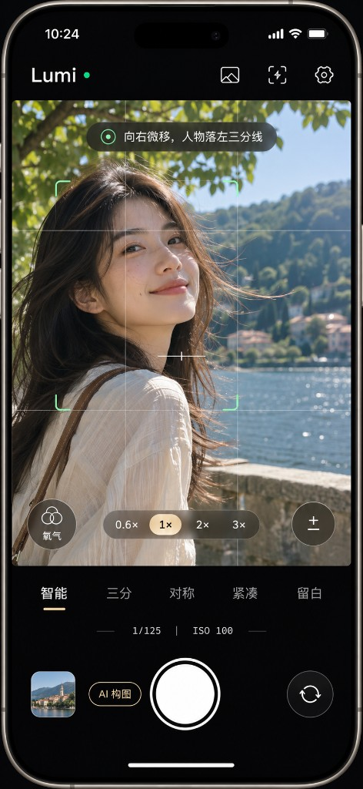

# Lumi 影像质感、AI 实时滤镜与特写/找光升级方案

**日期：** 2026-11-27　｜　**上位文档：** [Lumi 下一步产品与技术战略](../11.26/2026-11-26_Lumi下一步产品与技术战略.md)　｜　**适用阶段：** S6（阶段 A）→ S7/S8（阶段 B）

---

## 1. 需求背景与已对齐的产品决策

基于真实用户访谈反馈与现阶段真机实拍痛点，Lumi 在既有「构图绿环 + M4 挪步 + S4 光影遥测与曝光 + S5 参考图导演」基础上，新增 **4 项高感知能力**，并明确按 **阶段 A → 阶段 B** 分批推进：

| 批次 | 阶段编号 | 核心需求 | 已确认产品决策 |
| --- | --- | --- | --- |
| **阶段 A（优先执行）** | **S6.1** | **开启 / 关闭本机 AI 算法** | 提供明确开关：**本机优化（开）** vs **纯净原片（关）**，解决手机自带重度 AI 锐化/涂抹与 Lumi 调色打架的问题 |
| **阶段 A（优先执行）** | **S6.2** | **天气与环境感知 AI 实时动态滤镜** | **纯视觉 + 端侧光线传感器（零定位权限、不接外部天气 API）**；**1 原片 + 9 款精选氛围基底**；由 AI 按实时场景动态调节滤镜参数；**拍照直接保存带滤镜的所见即所得成片** |
| **阶段 A（优先执行）** | **S6.3** | **旗舰暗黑极简 UI 焕新** | 参照定稿视觉预览图重构取景器与操控台：纯黑画布 `#09090B` + 暖象牙金 `#F2E6C9` 点缀 + 祖母绿 `#34D399` 就绪态；快门行采用**摆法 1（左最近成片 / 中大快门 / 右 `AI 构图`，翻转放顶栏）**；滤镜与曝光底部抽屉互斥展开 |
| **阶段 B（后续执行）** | **S7** | **全景出特写裁剪框 + 变焦对准引导** | 在广角/全景取景时主动推荐 1–2 个局部特写框（半身/脸部/光影特写），屏幕弹出裁剪框并给出目标倍率，引导用户切换倍率对准框中心拍出高清特写 |
| **阶段 B（后续执行）** | **S8** | **找光与实测光位引导** | 基于纯视觉 + 端侧主体/四象限亮度分布实时测光与判别光位，给出找光方向与可执行调整口令 |

---

## 2. 阶段 A 详细设计（S6：本机优化开关 + AI 实时动态滤镜）

### 2.1 S6.1 开启 / 关闭本机 AI 算法（Native Camera Processing Toggle）

#### 现状与安卓底层事实
当前 `app/build.gradle.kts` 仅接入 `camera-camera2 / camera-lifecycle / camera-view`，尚未接入 `androidx.camera:camera-extensions`。真机拍摄时既无法显式开启厂商高阶 AI 扩展（HDR/夜景/Auto），也未主动关闭底层 ISP 的默认锐化与强降噪。

#### 两档模式定义

| 模式 | 界面文案 | 底层技术实现 | 适用场景 |
| --- | --- | --- | --- |
| **开启** | `本机优化：开` | 接入 `androidx.camera:camera-extensions`，通过 `ExtensionsManager` 动态探测当前镜头支持的扩展模式，按 `AUTO → HDR → 标准默认` 降级选择；支持夜景高光压制与多帧增强 | 不开滤镜快速随手拍、大光比/逆光依赖手机厂商 HDR 算力时 |
| **关闭** | `本机优化：关（纯净）` | 强制 `ExtensionMode.NONE`；结合 `CameraCharacteristics` 探测硬件可用值，通过 Camera2 下发：`CONTROL_SCENE_MODE_DISABLED`、温和档 `EDGE_MODE`（`FAST` 或 `OFF`）与 `NOISE_REDUCTION_MODE`（`FAST` 或 `MINIMAL`），并使用 `CAPTURE_MODE_MINIMIZE_LATENCY` 降低重度多帧涂抹 | **开启 Lumi 实时滤镜、拍摄胶片/CCD 质感、追求自然肤质与细节**，避免「手机浓艳锐化 + 滤镜」双重叠加 |

#### 兼容性与冲突规则
1. **能力动态探测，诚实反馈**：部分安卓机型不向第三方 App 开放 `Extensions`。若探测不可用，保留开关但明确提示「当前镜头未向第三方开放厂商扩展，关闭可降低默认锐化涂抹」。
2. **与 S4 `M 手动挡` 的协同**：CameraX Extensions 开启时多数机型会接管 AE/AWB 管线。当用户切入 `M 手动挡` 时，自动临时回退到非 Extension 管线以保证 `ISO / S / WB` 真正生效，并给出一句轻提示。
3. **默认策略**：用户手动开关的状态本地持久化；默认开启状态可随用户选择记住，切入自定义滤镜时可温和建议「关闭本机优化以获得更纯净色彩」（不强行篡改用户开关）。

---

### 2.2 S6.2 结合天气与环境的 AI 实时动态滤镜

#### 核心差异化：不是死板套 LUT，而是「氛围基底 + AI 实时调参」
静态滤镜的最大问题是「换个光线就翻车」（晴天好看的青橙滤镜到了阴天会发脏，暖调滤镜进了黄灯咖啡馆会满屏发黄）。
Lumi 采用 **双层驱动架构**：
- **层 1（氛围选型 + 参数基线）**：端侧提供 **原片 + 9 款高质量参数化基底**；云端 DS 看画面识别天气/光质/材质（晴空、雨后湿路、阴天漫射、夕阳逆光、暖灯室内、霓虹街景等），推荐最契合的基底及针对当前场景的参数微调偏移 + 12 字以内解释（如 `雨雾清新 · 柔化阴天反差`）。
- **层 2（端侧 60fps 实时自适应微调，零网络等待）**：结合 S4 现有 `LiveTelemetry`（`ambientLux`、`meanLuma`、`highlightClipPct`、`shadowClipPct`、`subjectVsBgDiff`），在基底参数上做轻量、带阻尼的连续自适应修正：
  - 高光溢出偏高（`highlightClipPct >= 8%`）→ 自动加大高光压制 `highlights`；
  - 强逆光（`subjectVsBgDiff <= -22`）→ 自动微抬 `shadows` 保人脸细节；
  - 暗光高 ISO（`ambientLux < 40` 或 `iso >= 1600`）→ 自动衰减人为 `grain` 防止叠噪点。

#### 精选预设清单（原片 + 9 款氛围基底）

| 编号 | ID | 名称 | 主打天气/环境 | 核心视觉特征 | AI 实时微调重点 |
| --- | --- | --- | --- | --- | --- |
| 0 | `original` | **原片自然** | 任意场景 | 零色彩染色，忠实还原现场 | 不介入 |
| 1 | `oxygen` | **晴日氧气** | 晴天、草地、海边、强日光 | 清透通亮、天空青蓝干净、绿叶清嫩、极轻高光柔润、肤色透亮 | 强日光压高光降硬反差；树荫下轻提明度保通透 |
| 2 | `mist` | **雨雾清新** | 雨天、阴天、薄雾、窗边漫射 | 日系低饱和青灰小清新、柔和灰调不发脏、**独立肤色保护不发青** | 照度偏低时收敛冷偏、微抬暗部防人脸发灰 |
| 3 | `golden` | **日落蜜糖** | 日出日落、逆光、秋景、暖阳 | 高光浸润暖琥珀金、阴影轻复古暖棕、逆光发丝氛围 | 检测到本就偏黄的室内灯光时自动减暖，避免发黄 |
| 4 | `classic_film` | **胶片纪实** | 城市街拍、人文、全天候百搭 | 阴影微青灰、高光微暖、黑位略抬呈哑光胶片感 + 细腻颗粒 | 暗光高 ISO 自动减弱人为颗粒 |
| 5 | `night_mood` | **霓虹夜色** | 蓝调时刻、夜市、雨夜灯光 | 深邃蓝青暗部、保留霓虹/暖灯色泽对比、灯牌不惨白 | 按高光溢出率压灯牌，有人像时优先护面部亮度 |
| 6 | `soft_portrait` | **奶油人像** | 室内日常、商场/餐厅顶光、近景人像 | 柔化硬光过渡、中和顶光偏绿/偏黄、肤质均匀柔和（非塑料磨皮） | 顶光/大光比时降低硬对比、柔化眼下鼻下阴影 |
| 7 | `monochrome` | **高级黑白** | 强光影、建筑几何、情绪特写 | 银盐质感黑白、清晰明暗过渡、中灰层次丰富、微颗粒 | 按画面动态范围动态收放对比度，避免死黑一片 |
| 8 | `retro_ccd` | **CCD 复古** | 复古街拍、晴天/闪光人像、千禧氛围 | 经典老数码冷白偏青调、高光轻微溢出柔晕、略硬锐感与轻暗角 | 强光下控制高光晕染上限防惨白，暗光保复古青调 |
| 9 | `cool_film` | **清冷胶片** | 阴晴建筑、海边阴天、极简情绪人像 | 电影感青蓝冷调、低饱和高质感、克制反差与高级疏离氛围 | 有人像时自动收住肤色区间冷偏，避免嘴唇/肤色发紫 |

#### 统一参数化调色引擎（确保预览 = 成片 100% 一致）

所有预设与 AI 调参统一收敛到一份轻量数据结构 `FilterGrade`（可在 JVM 端完整跑纯 Kotlin 单测）：

- **基础影调**：`exposure`（-0.5~+0.5）、`contrast`（-0.35~+0.45）、`highlights`（-0.6~+0.3）、`shadows`（-0.3~+0.6）、`fade`（黑位抬升 0~0.25）
- **色彩分离**：`temperature`（-0.4~+0.4）、`tint`（-0.3~+0.3）、`saturation`（-1.0~+0.4，黑白为 -1.0）、`vibrance`（自然饱和度 -0.3~+0.4）、`skinProtect`（肤色保护权重 0~1.0）
- **氛围分离色调与质感**：`shadowTintRgb`、`highlightTintRgb`、`glow`（高光柔晕/氧气感 0~0.35）、`grain`（胶片颗粒 0~0.25）、`vignette`（轻暗角 0~0.30）
- **全局强度**：`intensity`（0.0~1.0，默认 0.85；与原图线性混合，支持滑动条实时无级调节）

#### 渲染与保存管线（所见即所得）
1. **实时取景预览**：使用 CameraX `CameraEffect`（`TARGETS_PREVIEW`）挂载 OpenGL ES 2.0 片段着色器，直接在预览纹理上 60fps 渲染 `FilterGrade`，并支持参数变化时的 250ms 平滑插值（无画面跳变）。
2. **拍照直出成片（所见即所得）**：
   - 当滤镜为 `original` 且强度为 0 时，走现有零开销 `ImageCapture` 直存路径；
   - 当启用任意滤镜时，采集高分辨率图像并在后台线程使用 **同一份 GLSL 着色器（离屏 EGL 渲染）** 渲染成片，**完整保留 EXIF 信息**（方向、焦距、ISO、快门、机型），直接写入系统相册 `Pictures/Lumi` 并正常进入拍后复盘卡。

#### 交互与协议集成
1. **取景器 UI（保持零门槛克制）**：
   - 底部或侧边新增轻量「滤镜」胶囊入口（默认收起，不遮挡取景画面）；
   - 展开后显示横向滚动条：**`AI智能`（自动匹配+动态微调）** + `原片` + 9 款预设（带微型色卡圆点标识氛围），下方附一根简洁「强度」滑杆和 `AI微调：开/关` 切换；
   - AI 触发滤镜调整时，顶部轻提示条短暂展示 1 句人话解释（如 `晴日氧气 · 逆光柔化高光`），不打断构图绿环。
2. **云端 DS 协议扩展（`ChatProtocol.kt`）**：
   - 当滤镜处于 `AI智能` 或开启 `AI环境微调` 时，在现有单次推荐请求中**复用同一次视觉推理（零额外网络请求、零额外等待）**，让 DS 附带一个极短可选字段：
     ```json
     "filter": {
       "preset": "mist",
       "delta": {"temp": -0.06, "shadows": 0.12, "highlights": -0.10, "glow": 0.08},
       "reason": "阴雨柔光提通透"
     }
     ```
   - 端侧严格校验 `preset` 合法性并将 `delta` 钳位在安全微调区间内，杜绝模型输出异常把画面调崩。

---

### 2.3 S6.3 旗舰极简暗黑 UI 视觉与交互规范

#### 定稿视觉参考图



#### 视觉 Token 与克制原则
- **画布与材质**：深哑光纯黑底 `#09090B`（确保准确判断曝光与滤镜色彩）；磨砂深玻璃胶囊 `rgba(18, 20, 22, 0.72)` + 发丝描边 `1dp rgba(255, 255, 255, 0.14)`；状态栏强制亮白图标（修复原先深底黑字不可见问题）。
- **色彩克制**：
  - 主文字纯白 `#FFFFFF`，次级弱化 `rgba(255, 255, 255, 0.50)`；
  - 选中与激活点缀统一使用 **暖象牙金 `#F2E6C9`**（变焦激活丸、预设下划线、曝光锁定态、`AI 构图` 描边）；
  - **清透祖母绿 `#34D399`** 仅保留给「构图就绪 / 绿环 / AI 在线态」，告别廉价 AI 霓虹感与大四角星。
- **数字排版**：倍率与实时曝光遥测（`f/1.88 · 1/125 · ISO 100`）统一采用等宽数字风格。

#### 信息架构与最终布局（已采用「摆法 1」）

| 区域 | 布局规范与交互 |
| --- | --- |
| **顶部极简功能栏** | 左：正体 `Lumi` 字标 + 6dp 状态圆点（绿=就绪 / 琥珀=未配置 / 红=异常，点击直达模型设置）。<br>右：4 个极细线性图标——**翻转镜头**（前/后摄切换）、**参考图**（载入后显示微缩图并支持点按切换叠图）、**AI 模式/自动拍**（弹出轻菜单切换 `主动/手动/安静` 与 `自动拍`）、**设置**（统一收纳 `本机优化：开/关`、`九宫格开关`、`模型设置`、`偏好记忆`、`调试记录`）。 |
| **3:4 取景画面** | - 顶部居中：**单条磨砂玻璃引导胶囊**（构图 / 姿势口令 / 滤镜适配理由，一次只出一条，到位时切换绿勾）；<br>- 画面内：18% 透明度细九宫格、细边角主框、极简水平仪与绿环；<br>- 画面底部三点：左 **圆形磨砂「滤镜」键**（显示当前滤镜简称如 `氧气` / `AI`）、中 **紧凑单行变焦胶囊** `0.6× [1×] 2× 3×`（按住左右拖动展开精细刻度尺，松手收起，彻底取消常驻大黑半圆）、右 **圆形磨砂「±」曝光/M 挡键**。 |
| **底部互斥面板区** | 平时显示 **纯文字构图预设** `智能  三分  对称  紧凑  留白`（无灰底胶囊，选中项亮白 + 16dp 暖象牙金细下划线）+ 极简单行遥测 `f/1.88 | 1/125 | ISO 100`；<br>点左下 `滤镜` 时原地平滑切换为 **滤镜抽屉**（`AI智能` + `原片` + 9 款预设 + 强度滑杆 + AI 微调开关）；<br>点右下 `±` 时原地互斥切换为 **曝光抽屉**（`自动 / AI自动 / M手动` + `EV / ISO / S / WB / F`）。 |
| **底部快门行（摆法 1）** | 绝对对称三键，单手右手人体工学最优：<br>- **左**：46dp 圆角方形最近成片缩略图（点按打开拍后复盘与二次精裁）；<br>- **中**：68dp 经典双环机械感白色大快门（构图就绪时外环泛柔和祖母绿光，自动拍时绕外环走进度弧）；<br>- **右**：暖象牙金描边圆角 **`AI 构图`** 专属触发键（落在右手大拇指最顺手位置，手动触发和复测一键即达）。 |

---

## 3. 阶段 B 规划（S7：全景特写裁剪框 + S8：找光与光位诊断）

*在阶段 A 完成真机验证后启动，复用了阶段 A 与 S1–S5 全部底座能力。*

### 3.1 S7 全景出特写裁剪框 + 引导变焦对准

#### 核心痛点与体验闭环
用户先站在较远机位看全景/中景时，往往不知道画面里哪一块「裁成特写最好看」，而如果纯靠后期裁剪，放大到脸部或光影特写又会损失清晰度。

#### 方案设计（拍前真光学变焦为主 + 拍后精裁兜底）
1. **全景识别出 1–2 个高价值特写框**：
   - 触发场景：当前为广角/标准焦段（如 `0.6× ~ 1.2×`）且存在人像或光影结构；
   - 结合端侧 ML Kit 人脸框 / 分割掩码 + 云端 DS 推荐，生成 1–2 个语义特写候选框（如 `半身特写 · 2×`、`脸部特写 · 3×`、`光影特写 · 2.5×`）。
2. **取景器视觉与交互**：
   - 在全景取景画面中叠加柔和虚线裁剪框与标签胶囊（类似华为 AI 构图框，但更克制）；
   - 点击任意特写框后：
     - 自动换算目标倍率并**优先吸附设备真实光学长焦档位**（来自 `RearZoomStops`）；
     - 屏幕底部提示并一键切换目标倍率，同时把该特写框中心转换为目标锚点，**直接交给 Lumi 现有的姿态绿环引导用户对准框中心**；
     - 对准停稳后按下快门，直接得到真实长焦高清特写。
3. **拍后精裁增强**：
   - 升级 `PostShotRecrop.kt`，除现有「三分精裁 / 聚焦特写」外，利用已知人脸位置新增「半身特写」「脸部特写」选项，作为来不及变焦补拍时的零成本兜底。

### 3.2 S8 找光与实测光位引导（Light Finder）

#### 原则：纯视觉 + 端侧实时测光（零定位权限，室内外全通用）
1. **端侧实时光位定量分析**：
   - 在 `CompositionAnalyzer` 现有分析帧中，增加极低开销（<1ms）的亮度分布统计：
     - **画面四象限 + 边缘高光热点**：找出画面中最亮的光源来向（左/右/上/后）；
     - **人像面部左右侧亮度差 & 额头/下巴亮度差**：定量识别 **顺光 / 左侧光 / 右侧光 / 死亡顶光 / 强逆光**。
2. **取景器极简找光指引**：
   - 当检测到明显不利光位（如死亡顶光、面部发暗的硬逆光）或存在极佳侧光/窗光机会时，在取景器边缘以轻量化图标标出主光来向，并联动现有 `DirectorCue` 给出一句可执行口令（例如：`主光在右侧 · 侧身 30° 借侧光`、`头顶强光 · 退半步到阴影边缘`）。
3. **云端 DS 光影特写协同**：
   - 云端模型在检测到「窗光、树影光斑、丁达尔光、夕阳轮廓光」等高级光影机会时，输出光影落点建议，并可与 S7「光影特写框」打通。

---

## 4. 实施里程碑与验收标准

### 阶段 A（S6）拆解与验证

| 步骤 | 模块与主要改动文件 | 验收标准 |
| --- | --- | --- |
| **A1. 本机优化开关** | `app/build.gradle.kts`（加 `camera-extensions`）、`CameraSession.kt`、`ExposureControl.kt`、`MainActivity.kt` | 开关可持久化切换；无扩展机型优雅降级不崩溃；关闭模式下通过日志核实下发了温和 `EDGE/NOISE_REDUCTION/SCENE_MODE`；切 `M手动` 无参数冲突 |
| **A2. 滤镜数据模型与 9 预设** | 新增 `filter/FilterPreset.kt`、`filter/FilterAdjuster.kt` + 对应 JVM 单测 | 覆盖原片 + 9 款基底参数定义、端侧遥测自适应微调、DS `delta` 安全钳位与强度混合，单测全绿 |
| **A3. OpenGL ES 实时预览与离屏成片渲染** | 新增 `filter/FilterShader.kt`、`filter/PreviewFilterEffect.kt`、`filter/PhotoFilterRenderer.kt`、`CameraSession.kt` | 预览 60fps 流畅无卡顿/无倒置镜像错位；拍照成片色彩与预览肉眼一致，EXIF 完整保留，直接存入 `Pictures/Lumi` |
| **A4. AI 环境匹配协议与旗舰极简 UI 焕新（S6.3）** | `ChatProtocol.kt`、`Recommendation.kt`、`VisionChat.kt`、新增 `ui/FilterBar.kt`、重构 `ui/ZoomWheel.kt`、`ui/ExposurePanel.kt`、`ui/MainActivity.kt` | `AI智能` 能依据画面天气/光影自动选滤镜并动态微调参数；严格按定稿图与摆法 1 落地极简暗黑 UI（亮白状态栏、4 图标顶栏、紧凑单行变焦胶囊+拖动刻度尺、底部互斥滤镜/曝光抽屉、右拇指 `AI 构图` 键与机械大快门）；主机 `./gradlew :app:assembleDebug :app:testDebugUnitTest :app:lintDebug` 全通过 |

### 阶段 B（S7 + S8）拆解与验证（阶段 A 验收后启动）
- **B1（S7 特写框）**：广角取景自动弹出特写虚线框 -> 点击切至光学倍率 + 绿环对准中心 -> 成功拍出清晰特写；拍后复盘卡新增半身/脸部精裁。
- **B2（S8 找光引导）**：室内窗光/顶光、户外顺逆光 4 类场景下光位识别准确，能稳定输出主光方位指示与一句可执行找光口令。
